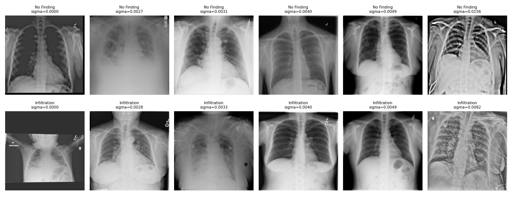
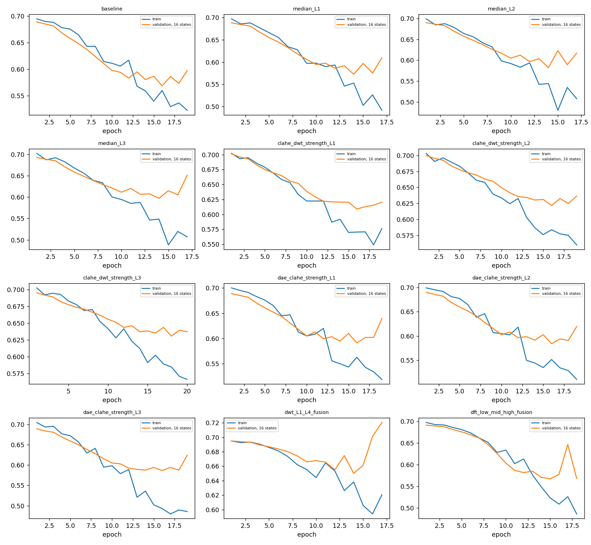
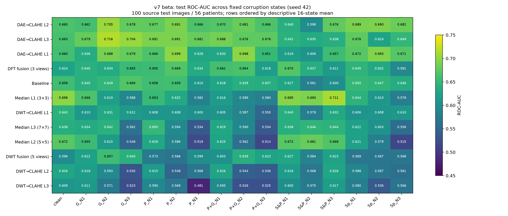
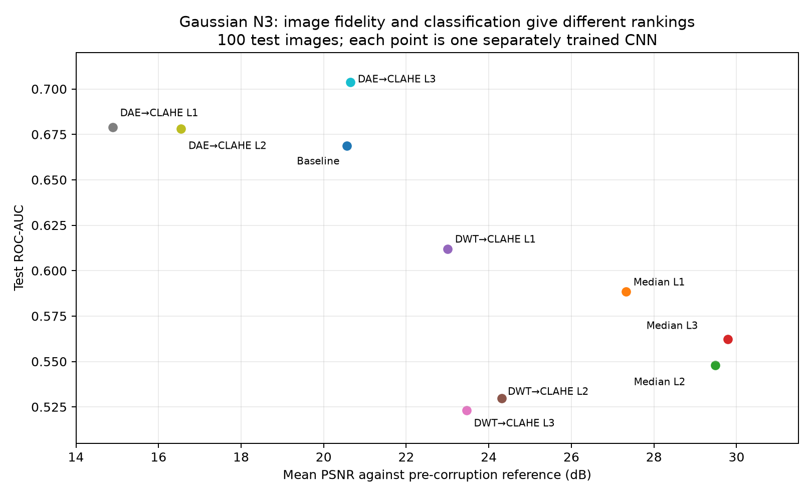

# v7 beta — ตัวไหนดีที่สุด และควรเลือกอะไรทำต่อ

ผลที่ตรวจจาก `MyDrive/nih -xray/Notebook_7_beta` ของ **faceyuslay@gmail.com**, วันที่ **16 ตุลาคม 2026**
งาน **Infiltration-only vs No Finding**; ใช้ ZIP v3 **70,012 ภาพ**, train **160 ต่อ class**,
ฝึก **12 CNN + 1 DAE**, seed **42**

อ่าน [สรุปการเลือกวิธีฉบับสั้น](RESULTS_CONCLUSION_TH.md) ได้โดยไม่ต้องอ่านรายละเอียดการเตรียมข้อมูลทั้งหมด

## ข้อสรุป: ควรเลือกตัวไหนจากผล v7 นี้

**ถ้าต้องเลือกเพียงตัวเดียวไปทำการทดลอง/XAI ต่อ ให้เลือก DAE→CLAHE L2 (`dae_clahe_strength_L2`) เป็นตัวหลัก**
เพราะในรอบนี้ได้ค่าเฉลี่ยทั้ง 16 สภาวะสูงสุดพร้อมกันทั้ง **ROC-AUC, AP, balanced accuracy และ F1**
เกณฑ์คำว่า “ดีที่สุดโดยรวม” ในสรุปนี้คือ ROC-AUC เฉลี่ยที่ให้น้ำหนักเท่ากันทั้ง 16 สภาวะ และตรวจ metric อื่นประกอบ
ไม่ใช่นับเฉพาะจำนวนสภาวะที่ชนะ

### 1. ทำไมเลือก DAE→CLAHE L2

| Metric เฉลี่ย 16 สภาวะ | Baseline | DAE→CLAHE L2 | สิ่งที่เปลี่ยน |
| --- | --- | --- | --- |
| ROC-AUC | 0.6367 | **0.6711** | **+0.0344** |
| AP | 0.6698 | **0.6920** | **+0.0222** |
| Balanced accuracy | 57.44% | **62.13%** | **+4.69 จุดเปอร์เซ็นต์** |
| F1 | 0.6049 | **0.6247** | **+0.0198** |
| Recall | **66.25%** | 63.38% | ลด 2.88 จุดเปอร์เซ็นต์ |
| Specificity | 48.63% | **60.88%** | **+12.25 จุดเปอร์เซ็นต์** |

**ความหมาย:** L2 แยก class โดยรวมได้ดีขึ้นและลดการทาย Infiltration ผิดในภาพ No Finding
แต่มี recall ต่ำกว่า Baseline เล็กน้อย จึงเป็นการแลก sensitivity กับ specificity ที่ threshold จาก validation ของแต่ละโมเดล
ไม่ได้ดีขึ้นทุก metric

**L2 ชนะ L3 เพราะอะไร:** AUC เฉลี่ยใกล้กันมาก — L2 **0.671050**, L3 **0.670475**, ห่างเพียง **0.000575**
แต่ L2 มี balanced accuracy **62.13% vs 60.81%**, F1 **0.6247 vs 0.5504**, recall **63.38% vs 49.00%**
ส่วน L3 มี specificity สูงกว่า (**72.63% vs 60.88%**) จึงเป็นอีกจุดทำงานที่เน้นทาย positive น้อยกว่า
ที่ threshold ที่เลือกไว้ ผลรอบนี้จึงสนับสนุนให้ใช้ L2 เป็นตัวหลักที่สมดุลกว่า โดยยังเก็บ L3 เป็นคู่เปรียบเทียบ

### 2. ถ้ารู้ชนิด noise ตัวไหนเด่นที่สุด

| ลักษณะภาพ / noise | วิธีที่ ROC-AUC สูงสุด | ROC-AUC | Baseline ROC-AUC |
| --- | --- | --- | --- |
| ภาพก่อนเติม noise | Median L1 | 0.6980 | 0.6580 |
| Gaussian เฉลี่ย N1–N3 | DAE→CLAHE L3 | 0.6995 | 0.6527 |
| Poisson เฉลี่ย N1–N3 | DAE→CLAHE L3 | 0.6876 | 0.6424 |
| Poisson–Gaussian เฉลี่ย N1–N3 | DAE→CLAHE L3 | 0.6796 | 0.6344 |
| Salt-and-pepper เฉลี่ย N1–N3 | Median L1 | 0.6988 | 0.6025 |
| Speckle เฉลี่ย N1–N3 | DAE→CLAHE L2 | 0.6873 | 0.6441 |

- **ภาพก่อนเติม noise → Median L1:** AUC **0.6980**, AP **0.7354** สูงสุดบน clean
- **Salt-and-pepper → Median L1:** นำทุกระดับ N1/N2/N3; เฉลี่ย AUC **0.6988** เทียบ Baseline **0.6025**
  สอดคล้องกับลักษณะ median filter ที่ลดพิกเซลผิดปกติแบบจุดในผลรอบนี้
- **Gaussian / Poisson / Poisson–Gaussian → DAE L3:** AUC เฉลี่ยในแต่ละ family สูงสุด
  แม้บางระดับจะมี DAE L1 หรือ L2 นำ ดูตารางแยก state ในส่วนผลละเอียด
- **Speckle → DAE L2:** AUC เฉลี่ย family **0.6873** สูงสุด โดย L1 นำเฉพาะ N2

**เหตุที่ไม่เลือก Median L1 เป็นตัวหลักของ noise รวม:** แม้ชนะ clean และ salt-and-pepper
แต่ AUC เฉลี่ยทั้ง 16 สภาวะเป็น **0.6344** ต่ำกว่า Baseline **0.6367** เล็กน้อย
ความสามารถที่เด่นกับ noise ชนิดหนึ่งจึงไม่แปลว่าจะเด่นกับทุกชนิด

### 3. อันดับครบ 12 วิธี และควรตีความอย่างไร

| อันดับตาม AUC รวม | วิธี | Mean ROC-AUC | Mean balanced acc. | ข้อสรุปจากรอบนี้ |
| --- | --- | --- | --- | --- |
| 1 | DAE→CLAHE L2 | 0.6711 | 62.13% | เลือกเป็นตัวหลักสำหรับรอบยืนยันและ XAI |
| 2 | DAE→CLAHE L3 | 0.6705 | 60.81% | ตัวเปรียบเทียบสำคัญ โดยเฉพาะ Gaussian/Poisson; recall ต่ำกว่า L2 |
| 3 | DAE→CLAHE L1 | 0.6596 | 60.69% | ดีขึ้นจาก Baseline แต่ไม่มี metric เฉลี่ยหลักที่นำ L2 |
| 4 | DFT fusion | 0.6401 | 57.44% | AUC เพิ่มเล็กน้อย แต่ balanced accuracy เท่า Baseline และใช้ 3 views |
| 5 | Baseline | 0.6367 | 57.44% | เก็บเป็น control ทุกครั้ง; เป็นจุดอ้างอิง ไม่ใช่ผู้ชนะ |
| 6 | Median L1 | 0.6344 | 60.13% | เก็บสำหรับ clean และ salt-and-pepper; ไม่ใช่ตัวหลักของ noise รวม |
| 7 | DWT→CLAHE L1 | 0.6080 | 58.94% | ดีที่สุดในกลุ่ม DWT→CLAHE แต่ AUC เฉลี่ยยังต่ำกว่า Baseline |
| 8 | Median L3 | 0.6074 | 57.19% | เด่นด้าน PSNR/SSIM ที่ N3 แต่ classification โดยรวมลดลง |
| 9 | Median L2 | 0.6039 | 54.94% | clean ดีพอสมควร แต่ noise รวมต่ำกว่า Baseline |
| 10 | DWT fusion | 0.6035 | 55.62% | ไม่เลือกเป็นตัวหลัก: AUC ต่ำกว่า Baseline และใช้ 5 views |
| 11 | DWT→CLAHE L2 | 0.5831 | 53.56% | ไม่ให้ความสำคัญในรอบถัดไป: แรงขึ้นแล้ว AUC ลดลง |
| 12 | DWT→CLAHE L3 | 0.5671 | 53.75% | ท้ายตาราง AUC รวมของรอบนี้; ไม่เลือกเป็นตัวหลัก |

**สิ่งที่เห็นจากแต่ละกลุ่ม**

- **DAE→CLAHE:** เป็นกลุ่มที่เด่นที่สุดด้าน classification รวมในรอบนี้ L2 สมดุลที่สุด ส่วน L3 น่าสนใจสำหรับ Gaussian/Poisson
- **Median:** L1 เหมาะกับ clean/salt-and-pepper; การเพิ่ม kernel เป็น L2/L3 ไม่ได้ทำให้ classifier ดีขึ้นโดยรวม
- **DWT→CLAHE:** AUC เฉลี่ยลดจาก L1 **0.6080** → L2 **0.5831** → L3 **0.5671**
  จึงยังไม่มีเหตุผลจากผลรอบนี้ให้เพิ่ม strength เพื่อหวังผล classification ที่ดีขึ้น
- **Fusion:** DFT ได้ AUC **0.6401** สูงกว่า Baseline เพียง **0.0034** และ balanced accuracy เท่ากัน
  ขณะที่ DWT fusion ได้ **0.6035** ต่ำกว่า Baseline ทั้งสองแบบใช้หลาย views จึงยังไม่ใช่ตัวเลือกหลักจากผลนี้

### 4. ถ้าถามว่า “ภาพ denoise สวย/ใกล้ต้นฉบับที่สุด” คำตอบต่างจาก classifier

ที่ noise ระดับ **N3**, Median L3 ให้ PSNR/SSIM สูงสุดใน Gaussian, Poisson, Poisson–Gaussian และ speckle
ส่วน Median L1 สูงสุดใน salt-and-pepper แต่ภาพใกล้อ้างอิงขึ้นไม่ได้รับรอง AUC ที่สูงขึ้น

ตัวอย่างชัดที่สุดคือ **Gaussian N3**:

| วิธี | PSNR | SSIM | ROC-AUC | สรุป |
| --- | --- | --- | --- | --- |
| Baseline | 20.56 dB | 0.2161 | 0.6688 | จุดอ้างอิง |
| Median L3 | **29.79 dB** | **0.7775** | 0.5624 | ภาพใกล้อ้างอิงขึ้น แต่ classifier ลดลง |
| DAE→CLAHE L3 | 20.64 dB | 0.5501 | **0.7036** | AUC สูงสุดใน state นี้ แม้ PSNR ไม่สูงสุด |

จึงต้องแยกเป้าหมาย **image fidelity** ออกจาก **classification**
PSNR/SSIM เทียบภาพก่อนเติม noise และรวมผลของ CLAHE ต่อ contrast ด้วย ไม่ใช่คะแนนคุณภาพทางคลินิก

### 5. เลือกอะไรไปทำต่อ

1. **ตัวหลัก: DAE→CLAHE L2** — ใช้ checkpoint `CNN/dae_clahe_strength_L2/best.pt`, best epoch **16**,
   validation threshold **0.612748** สำหรับรอบยืนยัน/XAI ต่อ
2. **ตัวเปรียบเทียบที่ควรเก็บ: Baseline + Median L1 + DAE L3** — เพื่อเทียบกับภาพไม่ denoise,
   จุดเด่น clean/salt-and-pepper และจุดเด่น Gaussian/Poisson ตามลำดับ
3. **ยังไม่เลือกเป็นตัวหลัก: DWT→CLAHE L2/L3 และ DWT fusion** — ค่า classification รวมไม่สนับสนุนในรอบนี้
   ส่วน Median L3 เก็บเป็นกรณีศึกษาที่ image fidelity สูงแต่ classification ลดลง

นี่คือข้อเสนอเลือก **ผู้สมัครสำหรับงานวิจัยรอบถัดไปจากผลเชิงพรรณนา** ไม่ใช่การเปลี่ยน checkpoint/threshold
ด้วย test หรือข้อสรุปประสิทธิภาพสำหรับการใช้งานจริง

### 6. ข้อสรุปนี้มั่นใจได้แค่ไหน

ผลนี้ทำให้เลือกทิศทางรอบถัดไปได้ แต่ยังยืนยัน “ชนะทุกกรณี” ไม่ได้: เป็น **seed 42 รอบเดียว**, test **100 ภาพ / 56 patients**
และ cohort ถูกเลือก noise ต่ำ ความต่าง AUC ระหว่าง L2/L3 เพียง 0.000575 ยังไม่มีหลักฐานว่าต่างกันจริง
paired CI ของ Median L1 เทียบ Baseline บน clean ยังคร่อมศูนย์ แม้ point estimate ของ Median L1 สูงสุด
ค่าเฉลี่ย 16 states ยังไม่มี CI รวมในรายงานเดิม และ CI ราย state ยังไม่ปรับ multiple comparisons

**คำตอบสุดท้ายสำหรับ v7 นี้:** เลือก **DAE→CLAHE L2 เป็นตัวหลักโดยรวม**,
ใช้ **Median L1 เมื่อสนใจ clean/salt-and-pepper**, และเก็บ **DAE L3 สำหรับ Gaussian/Poisson**
ก่อนอ้างผลทั่วไปควรยืนยันด้วยหลาย training seeds และตรวจผลของ AP/PA กับภาพ estimated sigma ใกล้ศูนย์

---

# รายละเอียดข้อมูลและหลักฐานประกอบ

## 1. Dataset ของ version นี้มาจากไหน

1. เริ่มจาก NIH ChestX-ray14 ต้นฉบับ **112,120 ภาพ** และ metadata / official lists เดิม
2. ใช้ ZIP ที่แพ็คไว้สำหรับ v3 ใน `MyDrive/nih -xray/data/v3_selected_zip/`: **12 image ZIP + metadata.zip** รวม **70,012 ภาพ** ขนาดหลังแตกประมาณ **26.26 GiB**
3. ภายใน ZIP มีภาพที่เข้าเกณฑ์สอง class **69,908 ภาพ**: No Finding **60,361**, Infiltration-only **9,547**
4. อีก **104 ภาพ** เป็นภาพที่เพิ่มเพื่อให้ bbox reference ครบ: XAI subset มี **123 ภาพ** โดย **19 ภาพ** อยู่ใน eligible cohort เดิมแล้ว และอีก 104 ภาพเป็น mixed-pathology cases ซึ่งไม่ถูกนำเข้า train/validation/test ของ binary classifier
5. ใช้ patient partition จาก release เดิม ภายใต้ official `train_val_list.txt` และ `test_list.txt`; **ไม่ได้แบ่ง patient ใหม่** และไม่ได้ใช้โรคอื่นเป็น negative

ผู้ใช้อนุมัติให้ใช้ ZIP เดิม **70,012 ภาพ** แทนการ audit NIH ทั้งหมด ผลจึงบันทึก
`metadata_images=112120`, `requested_images=70012`, `audited_images=70012`, `full_nih_complete=false`
ค่า `complete=true` ใน audit หมายถึงครบ **ขอบเขต ZIP ที่ร้องขอ** เท่านั้น

ใช้ `stage_dataset.py` ของ v3 แบบ byte-identical (SHA-256 `5870c0c32c79d62c2170ee9431cc435f586097540ac2b195ba84532ed60a9265`):
คัดลอก ZIP ทีละส่วนจาก Drive ตรวจ SHA-256 แตกลง `/content/cxr_v7_originals` แล้วลบเฉพาะ ZIP ชั่วคราวบน VM
การวิเคราะห์และฝึกอ่านภาพจาก Colab VM; checkpoint, manifests, ชุดภาพที่เลือก และผลลัพธ์เก็บกลับ Drive
notebook มี log ทันทีและ heartbeat ทุก 10 วินาที รวมถึงความคืบหน้าคัดลอก/แตก ZIP

## 2. วัด noise และเลือกภาพอย่างไร

ใช้ **estimated Gaussian noise จาก db2 wavelet MAD** เป็นคะแนนหลัก:
`sigma = median(abs(HH - median(HH))) / 0.67448975 / 255`
บน patch 64×64 ภายในกลาง 80% ของภาพ native โดยตัดขอบ coefficients ของแต่ละ patch ก่อนคำนวณ MAD
แต่ละ patch ต้องมีอย่างน้อย 90% ของพิกเซลอยู่ในช่วง 5–250 และไม่เป็นสีคงที่
ต้องเหลือ usable patches อย่างน้อย 8 patch แล้วใช้ median ของ sigma จาก patch ที่ gradient ต่ำสุด 25%
เก็บ global sigma, contrast, sharpness, patient ID, labels, split, view position และ SHA-256 ประกอบ

ผล audit: **70,012/70,012 ภาพเป็น `ok`**, ไม่มี read error หรือ insufficient-patch case
จากนั้นเรียง sigma ต่ำไปสูง **แยก class และ frozen partition**; หากเท่ากันเรียง image ID
ไม่มีการลดเกณฑ์หรือย้าย patient เพื่อเติมจำนวน

| ชุด | Class | ภาพต้นทางที่เข้าเกณฑ์ | เลือก | Patients ใน class | sigma ต่ำสุด | sigma median | sigma สูงสุด |
| --- | --- | --- | --- | --- | --- | --- | --- |
| train | No Finding | 40,371 | 160 | 151 | 6.24e-19 | 0.001460 | 0.001642 |
| train | Infiltration | 5,737 | 160 | 124 | 2.87e-34 | 0.001870 | 0.002167 |
| validation | No Finding | 10,129 | 40 | 39 | 0.000461 | 0.001459 | 0.001664 |
| validation | Infiltration | 1,590 | 40 | 34 | 0.000532 | 0.001901 | 0.002200 |
| test | No Finding | 9,861 | 50 | 34 | 7.17e-34 | 0.001554 | 0.001720 |
| test | Infiltration | 2,220 | 50 | 30 | 0.000811 | 0.001823 | 0.002083 |

sigma ในตารางใช้สเกลความเข้ม `[0,1]`; คะแนนต่ำหมายถึง **low estimated noise reference**
ไม่ได้รับรองว่าภาพไม่มี noise จริง หรือมีคุณภาพทางการวินิจฉัยดีกว่าภาพอื่น

| ชุด | No Finding | Infiltration-only | รวมภาพ | Unique patients |
| --- | --- | --- | --- | --- |
| Train | 160 | 160 | 320 | 264 |
| Validation | 40 | 40 | 80 | 69 |
| Test | 50 | 50 | 100 | 56 |
| รวม classification | 250 | 250 | 500 | 389 |

ตรวจแล้วไม่มี patient ซ้ำข้าม train/validation/test ผู้ป่วยหนึ่งคนอาจมีหลายภาพและมี labels ต่างกันภายใน partition เดียว
จึงบวกจำนวน patients ของสอง class ตรง ๆ ไม่ได้ และใช้ patient-bootstrap แทน image-bootstrap ในการประเมิน
ชุดภาพ native ที่เก็บจริงมี **621 ภาพ**: classification 500 ภาพ รวม bbox 123 ภาพ หักภาพที่ซ้ำกัน 2 ภาพ
background สำหรับ SHAP เป็น **16+16 ภาพจาก train เดิม** ไม่เพิ่มขนาด train

### ผลของการคัดเลือกต่อ AP/PA

| ชุด | Class | AP ใน eligible source | AP/PA หลังเลือก | AP หลังเลือก |
| --- | --- | --- | --- | --- |
| train | No Finding | 31.5% | 87/73 | 54.4% |
| train | Infiltration | 34.9% | 128/32 | 80.0% |
| validation | No Finding | 32.5% | 25/15 | 62.5% |
| validation | Infiltration | 37.9% | 33/7 | 82.5% |
| test | No Finding | 51.3% | 34/16 | 68.0% |
| test | Infiltration | 75.3% | 46/4 | 92.0% |

การคัด sigma ต่ำทำให้ AP เพิ่มขึ้นทุก class/partition; test Infiltration มี AP **46/50 ภาพ (92%)**
ขณะที่ test No Finding มี AP **34/50 ภาพ (68%)** จึงมีโอกาสที่ acquisition/view characteristics เกี่ยวข้องกับผล
ตารางนี้เป็นหลักฐานการเปลี่ยนองค์ประกอบข้อมูล ยังไม่ได้พิสูจน์ว่าโมเดลอาศัย view position เป็นตัวตัดสิน

### จุดที่ต้องตรวจภาพประกอบ

พบ sigma ใกล้ศูนย์ (`<1e-8`) **3 ภาพ** และทั้งสามถูกเลือกตามกฎเดิม:

| Image ID | ชุด | Class | estimated sigma |
| --- | --- | --- | --- |
| 00001136_001.png | train | No Finding | 6.235e-19 |
| 00018336_000.png | train | Infiltration | 2.867e-34 |
| 00011557_000.png | test | No Finding | 7.166e-34 |

ตรวจภาพประกอบแล้วพบพื้นที่เรียบ/ขอบภาพในบางตัวอย่าง เช่น `00018336_000.png` มีแถบสีเทาขนาดใหญ่ด้านบน/ล่าง
และ `00011557_000.png` มีพื้นที่ความเข้มเรียบมาก ค่าจาก MAD จึงอาจต่ำมากจากลักษณะภาพหรือการประมวลผลเดิม
ไม่ควรเรียกภาพเหล่านี้ว่า noise-free ไม่มีการตัดภาพเหล่านี้ออกย้อนหลังหรือเปลี่ยนชุด test ในรายงานนี้

## 3. เติม noise ที่ควบคุมได้

ย่อภาพอ้างอิงเป็น **256×256**, แปลงเป็น `[0,1]`, เติม noise แล้ว clip และ quantize เป็น uint8 ก่อน preprocessing

| ชนิด | N1 | N2 | N3 |
| --- | --- | --- | --- |
| Gaussian σ | 0.02 | 0.05 | 0.10 |
| Poisson peak count | 500 | 100 | 30 |
| Poisson–Gaussian (peak, σ) | 500, 0.01 | 100, 0.03 | 30, 0.05 |
| Salt-and-pepper amount | 0.005 | 0.02 | 0.05 |
| Speckle σ | 0.05 | 0.10 | 0.20 |

Gaussian เป็น additive; Poisson ใช้ `Poisson(peak×image)/peak`; แบบผสมเติม Gaussian ต่อจาก Poisson
salt-and-pepper สุ่มดำ/ขาวด้วยความน่าจะเป็นเท่ากัน; speckle ใช้ `image×(1+noise)`
รวม clean reference อีกหนึ่งสภาวะเป็น **16 states** โดยคำว่า clean ในชื่อ state หมายถึง **ก่อนเติม synthetic noise**

Train สุ่มหนึ่ง state ต่อภาพต่อ epoch รวม clean ด้วย จึงยังมีภาพต้นทาง **320 ภาพต่อ epoch**
RNG ขึ้นกับ seed/image ID/state/epoch และไม่ขึ้นกับ method; validation/test ใช้ corruption คงที่
ตรวจจาก predictions แล้วทุกโมเดลมี measured corruption statistics ตรงกันสำหรับ image/state เดียวกัน
Validation มี **80×16=1,280 predictions ต่อโมเดล**; test มี **100×16=1,600 predictions ต่อโมเดล**
รวม test predictions ของ 12 CNN เท่ากับ **19,200 แถว** ซึ่งยังมาจากเพียง **100 ภาพ/56 patients**

ค่าหลัง clip/quantization ไม่จำเป็นต้องเท่าพารามิเตอร์ที่ตั้ง เช่น Gaussian N3 มี mean measured std **0.09337**
และ clipping fraction **9.91%**; Poisson–Gaussian N3 มี clipping **11.49%**
ค่ารายภาพเก็บใน predictions และตาราง [noise ที่เกิดขึ้นจริง](results_summary/tables/measured_test_noise.csv)
การจำลองนี้ใช้วัด robustness ไม่ได้อ้างว่าเป็น noise ทางกายภาพของ NIH PNG จริง

## 4. วิธี preprocessing และโมเดลที่ใช้

| กลุ่ม | จำนวน CNN | สูตร |
| --- | --- | --- |
| Baseline | 1 | ภาพหลัง corruption ก่อน denoise |
| Median L1/L2/L3 | 3 | kernel 3/5/7 |
| DWT→CLAHE L1/L2/L3 | 3 | db1, depth 3, threshold multiplier 0.5/1/2, CLAHE clip 2 |
| DAE→CLAHE L1/L2/L3 | 3 | DAE ร่วมหนึ่งตัว, blend α 0.25/0.5/1, CLAHE clip 2 |
| DWT fusion | 1 | 5 views; ภาพฐานและ decomposition 4 ระดับ |
| DFT fusion | 1 | 3 views: low/mid/high |

รวม **12 CNN + 1 DAE** ไม่มี strength L4
ชื่อเดิม `dwt_L1_L4_fusion` หมายถึง decomposition ระดับ 1–4 ซึ่งยังเก็บไว้ ไม่ใช่ strength L4
CNN ใช้ ResNet50 ImageNet V2, input 224×224 และ ImageNet normalization
freeze early layers/BatchNorm; warmup head 3 epochs แล้วเปิด layer4; AdamW, pos_weight=1
CNN batch 4 × accumulation 4 = effective batch 16, สูงสุด 20 epochs, early stopping patience 3
augmentation ตาม release: rotation ±7°, translation 5%, scale 0.95–1.05, reflection padding
ใช้ AMP ตอน train; ปิด TF32 และประเมินแบบ float32 ตามที่บันทึกไว้

DAE ฝึกจาก train เท่านั้น โดยภาพเติม noise เป็น input และภาพก่อนเติมเป็น target
base channels 32, residual DAE, Adam lr 0.001, loss `MSE + 0.2×L1`
effective batch 64 จาก microbatch 8, ครบ **20 epochs**; checkpoint ที่ validation loss ต่ำสุดคือ
**epoch 19**, loss **0.002850**

เลือก CNN checkpoint ด้วย validation BCE ที่เฉลี่ยเท่ากันทั้ง 16 states
เลือก Youden threshold **หนึ่งค่าต่อโมเดลจาก validation รวม** แล้วตรึงใช้กับทุก test state; เก็บผล threshold 0.5 ประกอบ
ไม่ใช้ test เลือก epoch หรือ threshold ตารางอันดับด้านล่างเป็นการสรุปผลหลังประเมินแล้ว

| วิธี | epochs ที่รัน | best epoch | best validation BCE | Youden threshold | views |
| --- | --- | --- | --- | --- | --- |
| Baseline | 19 | 16 | 0.56873 | 0.497592 | 1 |
| Median L1 (3×3) | 17 | 14 | 0.57271 | 0.605735 | 1 |
| Median L2 (5×5) | 17 | 14 | 0.58195 | 0.533044 | 1 |
| Median L3 (7×7) | 17 | 14 | 0.59702 | 0.560574 | 1 |
| DWT→CLAHE L1 | 19 | 16 | 0.60895 | 0.531434 | 1 |
| DWT→CLAHE L2 | 19 | 16 | 0.62163 | 0.563466 | 1 |
| DWT→CLAHE L3 | 20 | 18 | 0.63056 | 0.511988 | 1 |
| DAE→CLAHE L1 | 19 | 16 | 0.59101 | 0.616319 | 1 |
| DAE→CLAHE L2 | 19 | 16 | 0.58392 | 0.612748 | 1 |
| DAE→CLAHE L3 | 19 | 16 | 0.58654 | 0.714872 | 1 |
| DWT fusion (5 views) | 17 | 14 | 0.65003 | 0.560173 | 5 |
| DFT fusion (3 views) | 18 | 15 | 0.56702 | 0.554546 | 3 |

เวลาที่บันทึกใน training histories รวม CNN ประมาณ **77.4 นาที**
และ DAE **8.8 นาที** ตัวเลขนี้รวม validation ต่อ epoch แต่ไม่รวมโหลด ZIP, audit,
prediction inference หลังฝึก และ bootstrap/report generation
โมเดลส่วนใหญ่มี train loss ลดต่อหลัง validation เริ่มแกว่ง จึงต้องใช้ best checkpoint ที่บันทึกไว้

## 5. ผล classification

Test แต่ละ state มี No Finding 50 / Infiltration 50 ภาพ จึงทำให้ accuracy เท่ากับ balanced accuracy ในแต่ละ state
ROC-AUC วัดการจัดอันดับ; `pr_auc` ในโค้ดคำนวณด้วย **average precision (AP)**
precision/recall/specificity/F1 ขึ้นกับ validation threshold ของแต่ละโมเดล

### 5.1 ค่าเฉลี่ยเท่ากันทั้ง 16 states

| วิธี | Mean ROC-AUC | ΔAUC vs Baseline | Mean AP | Mean balanced acc. | Mean F1 |
| --- | --- | --- | --- | --- | --- |
| DAE→CLAHE L2 | 0.6711 | +0.0344 | 0.6920 | 62.1% | 0.6247 |
| DAE→CLAHE L3 | 0.6705 | +0.0338 | 0.6695 | 60.8% | 0.5504 |
| DAE→CLAHE L1 | 0.6596 | +0.0229 | 0.6717 | 60.7% | 0.5961 |
| DFT fusion (3 views) | 0.6401 | +0.0034 | 0.6726 | 57.4% | 0.5786 |
| Baseline | 0.6367 | +0.0000 | 0.6698 | 57.4% | 0.6049 |
| Median L1 (3×3) | 0.6344 | -0.0022 | 0.6851 | 60.1% | 0.5668 |
| DWT→CLAHE L1 | 0.6080 | -0.0287 | 0.6195 | 58.9% | 0.5900 |
| Median L3 (7×7) | 0.6074 | -0.0293 | 0.6580 | 57.2% | 0.5532 |
| Median L2 (5×5) | 0.6039 | -0.0327 | 0.6578 | 54.9% | 0.5669 |
| DWT fusion (5 views) | 0.6035 | -0.0331 | 0.6137 | 55.6% | 0.6035 |
| DWT→CLAHE L2 | 0.5831 | -0.0536 | 0.6036 | 53.6% | 0.5392 |
| DWT→CLAHE L3 | 0.5671 | -0.0695 | 0.5783 | 53.8% | 0.5012 |

เป็นค่าเฉลี่ยของ metric ราย state ที่ให้น้ำหนักเท่ากัน ไม่ใช่ pooled AUC ของ 1,600 แถว
และไม่ได้ถือว่า 16 variants ของภาพเดียวกันเป็น independent test samples
ยังไม่มี patient CI สำหรับค่า macro นี้ในรายงานรันเดิม จึงไม่สรุปว่าค่าเฉลี่ย +0.0344 มีนัยสำคัญ
DAE L2 ให้ค่าเฉลี่ย ROC-AUC/AP/balanced accuracy/F1 สูงสุดในรอบนี้ ส่วน L3 มี specificity เฉลี่ยสูงกว่าแต่ recall ต่ำกว่า

### 5.2 ภาพก่อนเติม synthetic noise (`clean`)

| วิธี | ROC-AUC | 95% patient CI ของ AUC | AP | Balanced acc. | Recall | Specificity | F1 |
| --- | --- | --- | --- | --- | --- | --- | --- |
| Median L1 (3×3) | 0.6980 | 0.5747–0.8331 | 0.7353 | 60.0% | 62.0% | 58.0% | 0.6078 |
| Median L2 (5×5) | 0.6716 | 0.5362–0.8163 | 0.7211 | 61.0% | 68.0% | 54.0% | 0.6355 |
| DAE→CLAHE L2 | 0.6652 | 0.5469–0.7879 | 0.6883 | 59.0% | 64.0% | 54.0% | 0.6095 |
| DAE→CLAHE L3 | 0.6632 | 0.5449–0.7788 | 0.6716 | 62.0% | 54.0% | 70.0% | 0.5870 |
| DAE→CLAHE L1 | 0.6604 | 0.5457–0.7781 | 0.6829 | 64.0% | 68.0% | 60.0% | 0.6538 |
| Baseline | 0.6580 | 0.5187–0.7942 | 0.6895 | 58.0% | 84.0% | 32.0% | 0.6667 |
| DWT→CLAHE L1 | 0.6432 | 0.5143–0.7673 | 0.6739 | 63.0% | 74.0% | 52.0% | 0.6667 |
| Median L3 (7×7) | 0.6380 | 0.5076–0.7863 | 0.6944 | 59.0% | 52.0% | 66.0% | 0.5591 |
| DWT→CLAHE L2 | 0.6264 | 0.5064–0.7427 | 0.6430 | 55.0% | 58.0% | 52.0% | 0.5631 |
| DFT fusion (3 views) | 0.6236 | 0.4674–0.8227 | 0.6895 | 54.0% | 56.0% | 52.0% | 0.5490 |
| DWT→CLAHE L3 | 0.6088 | 0.4872–0.7334 | 0.6247 | 55.0% | 70.0% | 40.0% | 0.6087 |
| DWT fusion (5 views) | 0.5960 | 0.4518–0.7315 | 0.5906 | 59.0% | 44.0% | 74.0% | 0.5176 |

Median L1 มี AUC สูงสุด แต่ paired ΔAUC เทียบ Baseline บน clean เท่ากับ **+0.0400**
พร้อม 95% CI **[-0.0039, +0.0946]** ซึ่งคร่อมศูนย์
Baseline มี recall **84%** แต่ specificity **32%**: confusion matrix `[[16,34],[8,42]]`
ในลำดับ `[[TN,FP],[FN,TP]]` จึงไม่ควรใช้ F1 ที่สูงกว่าบางวิธีเพียงค่าเดียวเพื่อสรุปภาพรวม

### 5.3 เปรียบเทียบ ROC-AUC และ Accuracy ในแต่ละ state

**วิธีที่ AUC สูงสุดอาจไม่ใช่วิธีที่ Accuracy สูงสุด** ตารางแรกจึงเพิ่ม Accuracy ของผู้ชนะตาม AUC
เทียบ Baseline และตารางถัดมาเลือกผู้ชนะตาม Accuracy โดยตรง เพื่อไม่ปะปนเกณฑ์การจัดอันดับ

Accuracy ทั้งสองตารางใช้ **Youden threshold จาก validation ที่บันทึกไว้ของแต่ละโมเดล**
ตรึงใช้กับทุก test state ไม่ได้เลือก threshold ใหม่จาก test และไม่ใช่คอลัมน์ `accuracy_at_0_5`
แต่ละ state มี test **100 ภาพ (50+50)** ดังนั้น Accuracy 1 จุดเปอร์เซ็นต์เท่ากับทายถูกเพิ่ม 1 ภาพ
และ Accuracy เท่ากับ balanced accuracy เพราะจำนวนภาพสอง class เท่ากัน

**(ก) เลือกวิธีด้วย ROC-AUC แล้วเปรียบเทียบ Accuracy กับ Baseline**

| State | วิธีที่ AUC สูงสุด | ROC-AUC | Baseline AUC | ΔAUC | Accuracy ของวิธีนี้ | Baseline Accuracy | ΔAccuracy (จุดเปอร์เซ็นต์) |
| --- | --- | --- | --- | --- | --- | --- | --- |
| clean | Median L1 (3×3) | 0.6980 | 0.6580 | +0.0400 | 60% | 58% | +2 |
| gaussian_N1 | DAE→CLAHE L3 | 0.6792 | 0.6400 | +0.0392 | 66% | 53% | +13 |
| gaussian_N2 | DAE→CLAHE L3 | 0.7156 | 0.6492 | +0.0664 | 66% | 56% | +10 |
| gaussian_N3 | DAE→CLAHE L3 | 0.7036 | 0.6688 | +0.0348 | 66% | 60% | +6 |
| poisson_N1 | DAE→CLAHE L3 | 0.6912 | 0.6580 | +0.0332 | 64% | 58% | +6 |
| poisson_N2 | DAE→CLAHE L1 | 0.6992 | 0.6588 | +0.0404 | 62% | 57% | +5 |
| poisson_N3 | DAE→CLAHE L3 | 0.6808 | 0.6104 | +0.0704 | 56% | 59% | -3 |
| poisson_gaussian_N1 | DAE→CLAHE L3 | 0.6876 | 0.6276 | +0.0600 | 65% | 56% | +9 |
| poisson_gaussian_N2 | DAE→CLAHE L1 | 0.6980 | 0.6388 | +0.0592 | 63% | 59% | +4 |
| poisson_gaussian_N3 | DAE→CLAHE L3 | 0.6756 | 0.6368 | +0.0388 | 57% | 62% | -5 |
| salt_pepper_N1 | Median L1 (3×3) | 0.6952 | 0.6268 | +0.0684 | 62% | 60% | +2 |
| salt_pepper_N2 | Median L1 (3×3) | 0.6904 | 0.5808 | +0.1096 | 62% | 57% | +5 |
| salt_pepper_N3 | Median L1 (3×3) | 0.7108 | 0.6000 | +0.1108 | 61% | 53% | +8 |
| speckle_N1 | DAE→CLAHE L2 | 0.6892 | 0.6500 | +0.0392 | 62% | 56% | +6 |
| speckle_N2 | DAE→CLAHE L1 | 0.6928 | 0.6468 | +0.0460 | 60% | 56% | +4 |
| speckle_N3 | DAE→CLAHE L2 | 0.6824 | 0.6356 | +0.0468 | 62% | 59% | +3 |

ΔAUC เป็นผลต่างของ AUC ส่วน ΔAccuracy เป็น **จุดเปอร์เซ็นต์** เช่น 60% เทียบ 58% คือ +2 จุดเปอร์เซ็นต์
ค่า Accuracy ของวิธีในตารางนี้ไม่ได้หมายความว่าสูงสุดใน state นั้น ต้องดูตาราง (ข) ประกอบ

**(ข) เลือกวิธีด้วย Accuracy โดยตรง — แสดงทุกวิธีเมื่อคะแนนสูงสุดเท่ากัน**

| State | วิธีที่ Accuracy สูงสุด | Accuracy สูงสุด | Baseline Accuracy | ΔAccuracy (จุดเปอร์เซ็นต์) |
| --- | --- | --- | --- | --- |
| clean | DAE→CLAHE L1 | 64% | 58% | +6 |
| gaussian_N1 | DAE→CLAHE L3 | 66% | 53% | +13 |
| gaussian_N2 | DAE→CLAHE L3 | 66% | 56% | +10 |
| gaussian_N3 | DAE→CLAHE L1 | 68% | 60% | +8 |
| poisson_N1 | DAE→CLAHE L3 | 64% | 58% | +6 |
| poisson_N2 | DWT→CLAHE L1 | 64% | 57% | +7 |
| poisson_N3 | DAE→CLAHE L2 | 67% | 59% | +8 |
| poisson_gaussian_N1 | DAE→CLAHE L3 | 65% | 56% | +9 |
| poisson_gaussian_N2 | DAE→CLAHE L2 | 66% | 59% | +7 |
| poisson_gaussian_N3 | DAE→CLAHE L2 | 65% | 62% | +3 |
| salt_pepper_N1 | Median L1 (3×3) | 62% | 60% | +2 |
| salt_pepper_N2 | Median L1 (3×3) | 62% | 57% | +5 |
| salt_pepper_N3 | DAE→CLAHE L2 | 65% | 53% | +12 |
| speckle_N1 | DAE→CLAHE L3 | 64% | 56% | +8 |
| speckle_N2 | DAE→CLAHE L2 | 63% | 56% | +7 |
| speckle_N3 | DWT→CLAHE L1 | 66% | 59% | +7 |

**อ่านผลอย่างไร**

- บน **clean**, Median L1 มี AUC สูงสุด **0.6980** แต่ Accuracy **60%**;
  วิธีที่ Accuracy สูงสุดคือ **DAE→CLAHE L1 ที่ 64%** เทียบ Baseline **58%**
- บน **Poisson N3**, DAE L3 มี AUC สูงสุด แต่ Accuracy **56%** ต่ำกว่า Baseline **59%**;
  ถ้าเลือกด้วย Accuracy ต้องเป็น **DAE L2 ที่ 67%** จึงเห็นชัดว่า AUC ที่สูงขึ้นไม่ได้รับรอง Accuracy ที่สูงขึ้น
- ผู้ชนะตาม AUC กับ Accuracy เป็นคนละวิธีใน **10 จาก 16 states**; รอบนี้ไม่พบการเสมอที่ Accuracy สูงสุด
  DWT→CLAHE L1 นำ Accuracy ใน Poisson N2 และ speckle N3 แม้ไม่ได้เป็นผู้ชนะ AUC ในสอง state นี้
- ความต่างเกิดได้เพราะ AUC วัดการจัดอันดับโดยไม่ยึด threshold เดียว ขณะที่ Accuracy วัดการตัดสิน class
  ณ threshold ที่เลือกจาก validation ของแต่ละโมเดล จึงควรรายงานทั้งสองค่า
- สำหรับภาพรวม 16 states **DAE→CLAHE L2 ยังมีค่าเฉลี่ย Accuracy สูงสุด 62.125%**
  เทียบ Baseline **57.4375%** หรือเพิ่ม **4.6875 จุดเปอร์เซ็นต์** สอดคล้องกับอันดับ balanced accuracy ในข้อ 5.1
- ตารางนี้เป็นผลเชิงพรรณนาของรอบ seed 42 ไม่ได้ยืนยันว่าผู้ชนะ Accuracy มีนัยสำคัญทางสถิติ
  ช่วง paired patient-bootstrap ของ Accuracy อยู่ในข้อ 5.4 และไฟล์ paired deltas

ข้อมูลแยกไว้ใน [AUC winner พร้อม Accuracy](results_summary/tables/state_comparison_auc_accuracy.csv),
[Accuracy winners รวมกรณีเสมอ](results_summary/tables/accuracy_winners_by_state.csv) และ
[Accuracy matrix ครบ 12 วิธี × 16 states](results_summary/tables/accuracy_by_state.csv)
ตารางต้นฉบับทุก metric อยู่ใน [classification.csv](results_summary/tables/classification.csv)

### 5.4 Paired patient-bootstrap

รายงานเดิมสุ่มระดับ patient **2,000 ครั้ง** ให้ prediction ของ patient เดียวกันอยู่ร่วมกัน และเทียบแต่ละวิธีกับ
Baseline บน image IDs และ corruption state เดียวกัน โดยแต่ละโมเดลใช้ validation threshold ของตัวเอง
มี ROC-AUC comparisons **11×16=176 คู่**; ในจำนวนนี้ CI ของ ΔAUC อยู่เหนือศูนย์ 6 คู่ และต่ำกว่าศูนย์ 9 คู่
(ใช้ tolerance 1e-12 รอบศูนย์; อีกหนึ่งคู่มีขอบบนใกล้ศูนย์ในระดับ floating-point จึงไม่นับว่าต่ำกว่าศูนย์)

คู่ที่ ΔAUC มี CI อยู่เหนือศูนย์:

| วิธี | State | ΔAUC | 95% paired CI |
| --- | --- | --- | --- |
| Median L1 (3×3) | salt_pepper_N2 | +0.1096 | +0.0048 ถึง +0.2273 |
| Median L1 (3×3) | salt_pepper_N3 | +0.1108 | +0.0227 ถึง +0.2100 |
| DAE→CLAHE L2 | gaussian_N2 | +0.0560 | +0.0041 ถึง +0.1035 |
| DAE→CLAHE L2 | salt_pepper_N3 | +0.0764 | +0.0077 ถึง +0.1494 |
| DAE→CLAHE L3 | gaussian_N2 | +0.0664 | +0.0074 ถึง +0.1338 |
| DAE→CLAHE L3 | poisson_N3 | +0.0704 | +0.0082 ถึง +0.1247 |

CI เหล่านี้ **ยังไม่ได้ปรับ multiple comparisons** จึงเป็นหลักฐาน exploratory
ช่วง CI กว้างตามขนาด test 56 patients และ bootstrap นี้ไม่ครอบคลุมความแปรปรวนจากการฝึกด้วย seed อื่น
ตารางทุก metric รวมทั้งผลลบอยู่ใน [paired deltas](results_summary/tables/paired_classification_deltas.csv)

## 6. คุณภาพภาพกับ classification ให้ข้อสรุปเหมือนกันหรือไม่

PSNR/SSIM เทียบกับภาพก่อนเติม synthetic noise ของภาพเดียวกัน เป็น **reference proxy**
ผลนี้รวมการเปลี่ยน contrast จาก CLAHE ด้วย จึงไม่ใช่คะแนน denoising เพียงอย่างเดียวหรือคะแนนคุณภาพทางคลินิก
DWT/DFT fusion เป็น representation หลาย view จึงระบุ `representation_only` และไม่มี PSNR/SSIM

ตัวอย่าง **Gaussian N3**:

| วิธี | Mean PSNR (dB) | Mean SSIM | Test ROC-AUC |
| --- | --- | --- | --- |
| Baseline | 20.56 | 0.2161 | 0.6688 |
| Median L1 (3×3) | 27.32 | 0.5289 | 0.5884 |
| Median L2 (5×5) | 29.49 | 0.7083 | 0.5480 |
| Median L3 (7×7) | 29.79 | 0.7775 | 0.5624 |
| DWT→CLAHE L1 | 23.00 | 0.5202 | 0.6120 |
| DWT→CLAHE L2 | 24.31 | 0.5905 | 0.5296 |
| DWT→CLAHE L3 | 23.46 | 0.5629 | 0.5232 |
| DAE→CLAHE L1 | 14.89 | 0.1452 | 0.6788 |
| DAE→CLAHE L2 | 16.54 | 0.1972 | 0.6780 |
| DAE→CLAHE L3 | 20.64 | 0.5501 | 0.7036 |

Median L3 เพิ่ม PSNR จาก Baseline **20.56 → 29.79 dB** และ SSIM **0.2161 → 0.7775**
แต่ ROC-AUC ลดจาก **0.6688 → 0.5624** จึงเห็นว่าความใกล้เคียงภาพอ้างอิงสูงขึ้นไม่ได้รับรอง classification ที่ดีขึ้น
สอดคล้องกับความเป็นไปได้เรื่อง over-smoothing แต่ผลนี้ยังแยกสาเหตุจากการฝึก/การเปลี่ยน representation ไม่ได้
ใน salt-and-pepper N3 Median L1 ได้ **37.70 dB / SSIM 0.9786 / AUC 0.7108**
ส่วน clean Baseline ได้ PSNR=∞ และ SSIM=1 เพราะเป็นภาพอ้างอิงเดียวกัน ไม่ใช่หลักฐานคุณภาพเหนือวิธีอื่น

## 7. ความครบถ้วนของผลและสิ่งที่เตรียมให้ XAI

พบ completion receipts ของ DAE, CNN ทั้ง 12 ตัว, evaluation ทั้ง 12 ตัว และ report
รายงานมี **192 classification rows**, **1,536 metric-CI rows**, **1,408 paired-delta rows**
ตรวจ hash ของตาราง/manifest/predictions ที่อ่าน, source hashes, patient isolation, strict labels,
อันดับการคัด noise, validation thresholds และคำนวณ test metrics ซ้ำจาก predictions แล้วตรงกับรายงาน
รายละเอียดอยู่ใน [verification.json](results_summary/verification.json)
การตรวจครั้งนี้อ่านผลและ metadata; ไม่ได้ reload หรืออ่าน bytes ของไฟล์ weights ขนาดใหญ่ซ้ำ

เก็บ `best.pt`, `last.pt`, `model_spec.json`, true logits/probabilities และ predictions แยกแต่ละ state
XAI ใช้ loader/preprocessing ร่วม: input `(N,V,3,H,W)`, output Infiltration logit `(N,1)`,
target layer `backbone.layer4`, พร้อม view order/normalization/native geometry และ input gradients
มี bbox **123 ภาพ / 115 patients**: pure 19, mixed_high_risk 64, mixed_low_risk 40
และ background **32 ภาพ / 30 patients** จาก train; ยังไม่มี Grad-CAM/SHAP heatmaps หรือ IoU/Pointing Game results

## 8. ข้อจำกัดและงานต่อที่ผลรอบนี้สนับสนุน

- เป็น cohort ที่เลือก estimated noise ต่ำ จึงใช้แทนการกระจาย NIH ทั้งหมดไม่ได้ และ audit ครบเฉพาะ ZIP 70,012 ภาพ
- การคัด noise เปลี่ยนสัดส่วน AP/PA และมี 3 ภาพ sigma ใกล้ศูนย์ ควรทบทวน ROI/ภาพตัวอย่างก่อนออกแบบการทดลองรุ่นถัดไป
- test 100 ภาพมาจาก 56 patients, ฝึกหนึ่ง seed; ไม่ควรตีความความต่างระดับไม่กี่จุดเป็นข้อสรุปทั่วไป
- เปรียบเทียบหลาย methods/states โดยไม่ปรับ multiplicity; การจัดอันดับผู้ชนะบน test เป็น post-hoc description
- ยังไม่ได้ทดสอบข้อมูลภายนอก และภาพอ้างอิงไม่ได้เป็น detector noise-free ground truth
- หากทำรอบยืนยัน ควรกำหนดวิธี/metric หลักไว้ก่อนรัน เพิ่ม training seeds และวิเคราะห์แยก AP/PA โดยคง patient isolation
- ขั้น XAI ถัดไปใช้ checkpoint ที่เลือกด้วย validation เดิมและ bbox ที่เก็บไว้ได้ โดยรายงาน localization แยก pure/mixed cases

## 9. ไฟล์อ้างอิงและการใช้ต่อ

| ตำแหน่งใน `Notebook_7_beta/` | เนื้อหา |
| --- | --- |
| `audit_v3_zip_70012/noise_audit.csv` | คะแนน noise และ provenance รายภาพ 70,012 ภาพ |
| `prepared/manifests/` | train/validation/test/xai/background ที่ใช้จริง |
| `selected_data/`, `v7_selected_data.zip` | native images และ manifests สำหรับใช้ซ้ำ |
| `runs/v7_beta/seed_42/DAE/` | DAE checkpoint/history |
| `runs/v7_beta/seed_42/CNN/<method>/` | CNN checkpoints, histories, specs, predictions |
| `runs/v7_beta/seed_42/reports/` | รายงานต้นฉบับและ completion receipt ที่ไม่ถูกแก้ไข |
| `results_summary/` | สำเนาตารางที่ใช้อ่านผล, ตารางสรุปเพิ่ม, figures และหลักฐานการตรวจ |
| `results_summary/source_snapshot.json` | SHA-256 ของ 93 result/manifest/source-receipt files ที่อ่านจาก Drive |
| [RUN_GUIDE.md](RUN_GUIDE.md) | คู่มือรันเดิม เก็บแยกจากสรุปผลนี้ |

Run signature: `7fb78156f3df5ad49845b9258552b28c7af28e2292ad68968dd7fac56b09e2bb`

Audit CSV SHA-256: `5a979a70afb38643ef1a7ccf48f18725f7a982e307639eec5ca1a592ad3e2658`

Environment ที่บันทึกในรอบจริง: PyTorch **2.11.0+cu130**, torchvision **0.26.0+cu130**,
NumPy **2.1.3**, pandas **2.2.3**, PyWavelets **1.10.0**,
scikit-learn **1.6.1**, SciPy **1.16.3**
ไม่พบชื่อ GPU ใน saved experiment metadata จึงไม่ระบุ GPU ของรอบนี้จากการคาดเดา

ตัวเลขใน README มาจาก saved artifacts ของรอบนี้ทั้งหมด ไม่มีการฝึกใหม่ เปลี่ยน checkpoint/threshold
หรือแก้ signed report artifacts ระหว่างจัดทำสรุป
