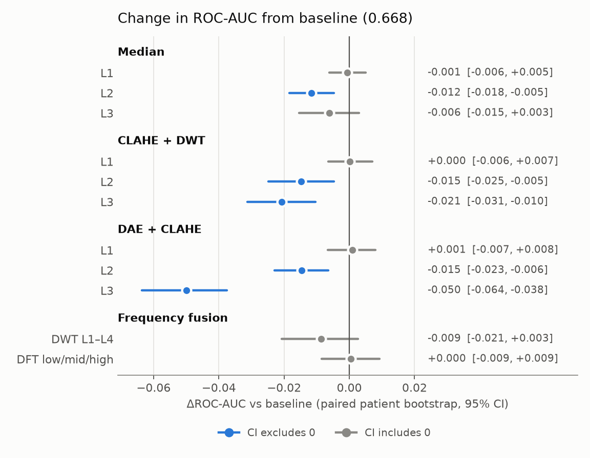
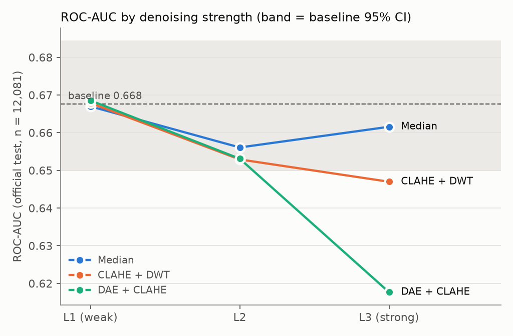

# ผลเปรียบเทียบวิธีลดสัญญาณรบกวนต่อการจำแนก Infiltration ด้วย CNN

**Release v4 · training seed 42 · NIH ChestX-ray14 official test (n = 12,081)**

> ไฟล์นี้สรุปผลสำหรับนำเสนอ ตัวเลขทั้งหมดมาจากไฟล์ในโฟลเดอร์นี้ ([classification.csv](classification.csv),
> [classification_cis.csv](classification_cis.csv), [paired_classification_deltas.csv](paired_classification_deltas.csv))
> ส่วน [README.md](README.md) เป็นรายงานที่ pipeline สร้างอัตโนมัติ

---

## สรุปสั้น

1. **การลดสัญญาณรบกวนไม่ได้ทำให้การจำแนกดีขึ้น** — ไม่มีวิธีใดได้ ROC-AUC สูงกว่า baseline (0.668) อย่างมีนัยสำคัญ
2. **ความแรงระดับต่ำ (L1) เทียบเท่า baseline** — Median, CLAHE+DWT และ DAE+CLAHE ที่ L1 ต่างจาก baseline ไม่เกิน ±0.001
3. **ยิ่งลดสัญญาณรบกวนแรง ผลยิ่งแย่ลง (over-smoothing)** — ที่ L2 ทุกวิธีลดลงอย่างมีนัยสำคัญ (−0.012 ถึง −0.015)
   และ DAE+CLAHE L3 ลดลงมากที่สุด (−0.050, 95% CI −0.064 ถึง −0.038)
4. **Frequency fusion (DWT/DFT) ไม่ต่างจาก baseline** อย่างมีนัยสำคัญ

---

## การตั้งค่าการทดลอง

| หัวข้อ | รายละเอียด |
|---|---|
| Dataset | NIH ChestX-ray14, official patient-level split (ไม่ได้แบ่งใหม่) |
| งาน | Binary: Infiltration อย่างเดียว vs No Finding อย่างเดียว |
| จำนวนภาพ | train 46,108 · validation 11,719 · test 12,081 (Infiltration 18.4%) |
| Model | ResNet50 (ImageNet `IMAGENET1K_V2`), train head 3 epoch แล้วเปิด layer4 (lr 1e-5), BatchNorm frozen |
| Loss | Weighted BCE (pos_weight 7.04) |
| Input | ปรับขนาดเป็น 256 แล้วครอปเป็น 224, augmentation แบบเบา (หมุน ±7°, เลื่อน 5%, scale 0.95–1.05) |
| Early stopping | patience 3 บน validation loss, ใช้ checkpoint ที่ validation loss ต่ำสุด |
| Threshold | แต่ละโมเดลเลือก threshold เองด้วย Youden J บน validation |
| ความไม่แน่นอน | 95% patient-level bootstrap (2,000 รอบ), paired delta ใช้การสุ่มผู้ป่วยชุดเดียวกัน |

### วิธีลดสัญญาณรบกวนและระดับความแรง

| กลุ่ม | L1 (อ่อน) | L2 | L3 (แรง) |
|---|---|---|---|
| Median filter | kernel 3 | kernel 5 | kernel 7 |
| CLAHE + DWT (db1, depth 3, clip 2.0) | threshold × 0.5 | threshold × 1.0 | threshold × 2.0 |
| DAE + CLAHE (clip 2.0) | ผสม DAE 25% | ผสม DAE 50% | ผสม DAE 100% |

Frequency fusion ทดลองแยกเป็น representation experiment: **DWT L1–L4** (db1, depth 4) และ
**DFT low/mid/high** (cutoff 0.125 / 0.25 cycles/pixel)

---

## ผลการจำแนก (official test, n = 12,081)

| วิธี | ROC-AUC [95% CI] | PR-AUC | Balanced acc. | F1 | Recall | Specificity | Accuracy |
|---|---|---|---|---|---|---|---|
| **Baseline** | **0.668** [0.650, 0.684] | 0.310 | 0.586 | 0.349 | 0.835 | 0.336 | 0.428 |
| Median L1 | 0.667 [0.649, 0.684] | 0.314 | 0.587 | 0.349 | 0.799 | 0.375 | 0.453 |
| Median L2 | 0.656 [0.638, 0.673] | 0.300 | 0.577 | 0.343 | 0.830 | 0.324 | 0.417 |
| Median L3 | 0.662 [0.643, 0.680] | 0.304 | 0.566 | 0.338 | 0.879 | 0.252 | 0.367 |
| CLAHE+DWT L1 | 0.668 [0.649, 0.685] | 0.318 | 0.589 | 0.351 | 0.807 | 0.371 | 0.451 |
| CLAHE+DWT L2 | 0.653 [0.635, 0.669] | 0.301 | 0.579 | 0.345 | 0.821 | 0.337 | 0.426 |
| CLAHE+DWT L3 | 0.647 [0.628, 0.664] | 0.296 | 0.584 | 0.347 | 0.770 | 0.398 | 0.466 |
| DAE+CLAHE L1 | 0.669 [0.650, 0.685] | 0.314 | 0.583 | 0.347 | 0.828 | 0.337 | 0.427 |
| DAE+CLAHE L2 | 0.653 [0.635, 0.670] | 0.302 | 0.574 | 0.342 | 0.863 | 0.285 | 0.391 |
| DAE+CLAHE L3 | 0.618 [0.598, 0.636] | 0.272 | 0.563 | 0.333 | 0.787 | 0.338 | 0.421 |
| DWT L1–L4 fusion | 0.659 [0.639, 0.678] | 0.306 | 0.574 | 0.342 | 0.836 | 0.313 | 0.409 |
| DFT low/mid/high fusion | 0.668 [0.650, 0.684] | 0.314 | 0.581 | 0.346 | 0.832 | 0.330 | 0.422 |

PR-AUC ของตัวจำแนกแบบสุ่มเท่ากับ prevalence = 0.184

### ผลต่างเทียบ baseline (paired bootstrap)

`*` = 95% CI ไม่คร่อม 0

| วิธี | ΔROC-AUC [95% CI] | ΔPR-AUC | ΔBalanced acc. | ΔF1 |
|---|---|---|---|---|
| Median L1 | −0.001 [−0.006, +0.005] | +0.004 | +0.001 | +0.000 |
| Median L2 | −0.012 [−0.018, −0.005] * | −0.010 * | −0.009 * | −0.006 * |
| Median L3 | −0.006 [−0.015, +0.003] | −0.006 | −0.020 * | −0.011 * |
| CLAHE+DWT L1 | +0.000 [−0.006, +0.007] | +0.008 | +0.003 | +0.002 |
| CLAHE+DWT L2 | −0.015 [−0.025, −0.005] * | −0.009 | −0.006 | −0.005 |
| CLAHE+DWT L3 | −0.021 [−0.031, −0.010] * | −0.014 | −0.002 | −0.003 |
| DAE+CLAHE L1 | +0.001 [−0.007, +0.008] | +0.004 | −0.003 | −0.002 |
| DAE+CLAHE L2 | −0.015 [−0.023, −0.006] * | −0.008 | −0.012 * | −0.007 * |
| DAE+CLAHE L3 | −0.050 [−0.064, −0.038] * | −0.037 * | −0.023 * | −0.016 * |
| DWT L1–L4 fusion | −0.009 [−0.021, +0.003] | −0.004 | −0.011 * | −0.007 * |
| DFT low/mid/high fusion | +0.000 [−0.009, +0.009] | +0.004 | −0.005 | −0.003 |

---

## การอ่านผล

**ทำไมใช้ ROC-AUC เป็นตัวชี้วัดหลัก ไม่ใช่ accuracy**

- test มี Infiltration เพียง 18.4% โมเดลที่ทาย No Finding ทุกภาพจะได้ accuracy 0.816 ทั้งที่ตรวจไม่พบโรคเลย
- accuracy ขึ้นกับ threshold; threshold จาก Youden J ให้ recall สูง (~0.8) แต่ specificity ต่ำ (~0.3)
  accuracy จึงอยู่ที่ 0.37–0.47
- ความต่างของ accuracy ระหว่างวิธีส่วนใหญ่มาจาก threshold ที่ต่างกัน ไม่ได้มาจากความสามารถแยกคลาส
  เช่น CLAHE+DWT L3 มี accuracy สูงสุด (0.466) แต่ ROC-AUC ต่ำกว่า baseline อย่างมีนัยสำคัญ
- ROC-AUC และ PR-AUC ไม่ขึ้นกับ threshold จึงใช้เทียบวิธีได้ตรงกว่า; ถ้าต้องรายงานค่าที่ใช้ threshold
  ควรใช้ balanced accuracy หรือ F1

**ระดับ ROC-AUC โดยรวม (~0.67) ต่ำเพราะ label ของ NIH**

label ของ NIH สกัดจาก radiology report ด้วย NLP และ Infiltration เป็นหนึ่งในคลาสที่ label noise สูงที่สุด
การทดลองใน [Notebook_5 beta](../Notebook_5%20beta/results/SUMMARY.md) ไม่พบ bug ใน pipeline;
เมื่อนำ prediction ชุดเดียวกันไปวัดกับ label ของรังสีแพทย์ (Google, Majkowska et al.) ROC-AUC ของ baseline
เพิ่มจาก 0.691 เป็น 0.737 ([google_labels_eval_best_seed_42.md](../Notebook_5%20beta/results/google_labels_eval_best_seed_42.md))

---

## ข้อจำกัด

- **seed เดียว (42)** — CI สะท้อนความไม่แน่นอนจากการสุ่มผู้ป่วยใน test เท่านั้น ยังไม่รวมความแปรปรวนจากการ train;
  config กำหนด seed 42/43/44 ไว้แต่ยังไม่ได้รัน 43 และ 44
- **ผลไม่เป็นเส้นตรงเสมอไป** — Median L3 ได้ ROC-AUC สูงกว่า L2 ซึ่งอาจเป็นความแปรปรวนของ seed เดียว
- **XAI ยังไม่ได้รัน** — Grad-CAM และ SHAP มีสถานะ `not_run` ทุก condition ([status.csv](status.csv));
  ผล IoU / Pointing Game บน bounding box 123 ภาพจึงยังไม่มี
- ช่วงห่างระหว่าง validation loss และ train loss ที่ epoch สุดท้ายอยู่ที่ 0.06–0.15 ([overfit_summary.csv](overfit_summary.csv))
  และทุกโมเดลหยุดด้วย early stopping

---

## ไฟล์ในโฟลเดอร์นี้

| ไฟล์ | เนื้อหา |
|---|---|
| [classification.csv](classification.csv) | metric ทุกตัวของทุกวิธี |
| [classification_cis.csv](classification_cis.csv) | 95% bootstrap CI |
| [paired_classification_deltas.csv](paired_classification_deltas.csv) | ผลต่างเทียบ baseline แบบ paired |
| [overfit_summary.csv](overfit_summary.csv) | train/validation loss ของ epoch ที่ดีที่สุดและ epoch สุดท้าย |
| `<condition>/confusion.png`, `roc_pr.png`, `training.png` | กราฟรายวิธี |
| [training_curves.png](training_curves.png) | learning curve ทุกวิธี |
| [figures/](figures/) | กราฟในเอกสารนี้ |
